## 1. VM gráfica (`g01-grafica` - Kubuntu)

Instalamos Kubuntu en VirtualBox con particionado manual (`/`, `swap` y `/home`), sin usar el particionado automático.

| Partición | Tamaño | Por qué |
|---|---|---|
| `/` | 13.67 GB | Contiene el sistema operativo completo, el entorno gráfico KDE Plasma y los paquetes instalados, dejando margen para actualizaciones. |
| `swap` | 2 GB | Memoria de intercambio equivalente a la RAM asignada a la VM para respaldar el sistema si se agota la memoria física. |
| `/home` | 9.33 GB | Separa los archivos personales, configuraciones y capturas del usuario respecto a los archivos del sistema. |

**Navegadores y editores instalados:** Firefox y Brave; Vim y nano.

**Comandos ejecutados:** `date`, `lsblk`, `df -h`, `cat /etc/fstab`

**Captura 1: Editor de particiones manual durante la instalación de Kubuntu**
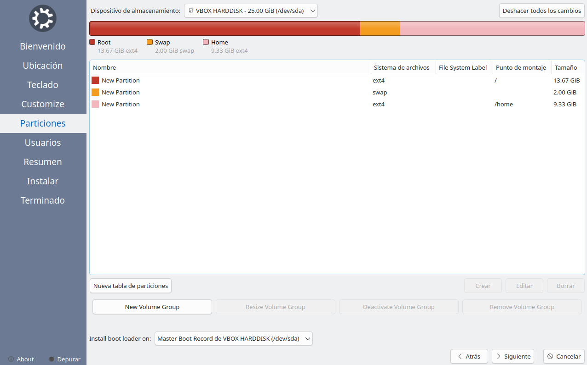


**Captura 2: Salida de `lsblk`, `df -h` y `cat /etc/fstab` con el prompt `nicolas@g01-grafica` y `date` visible**
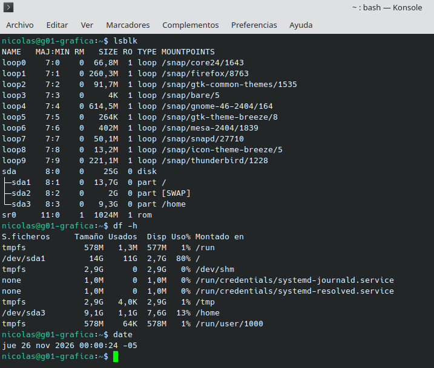
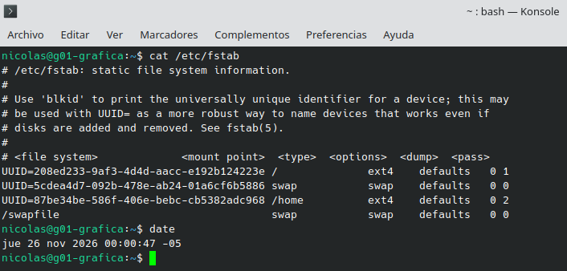

**Captura 3: Los dos navegadores y los dos editores abiertos en Kubuntu**
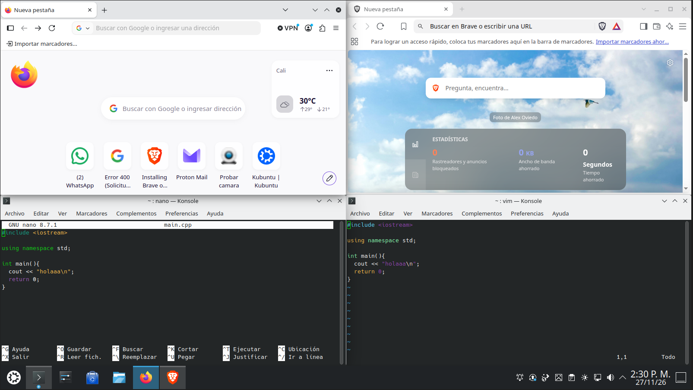

---

## 2. VM de consola (`g01-consola` - Debian)

Instalamos Debian en modo consola (sin entorno gráfico) en VirtualBox con un disco de 25 GB, 2 CPU y particionado manual (`/`, `/var`, `swap` y `/home`).

| Partición | Tamaño | Por qué |
|---|---|---|
| `/` | 6.4 GB | Contiene el sistema operativo base Debian sin entorno gráfico y los paquetes esenciales. |
| `/var` | 12.9 GB | Directorio donde Docker y Minikube almacenarán sus imágenes, contenedores y volúmenes en los siguientes sprints (`/var/lib/docker`). |
| `swap` | 2.1 GB | Área de intercambio en disco para respaldar la memoria RAM asignada a la máquina virtual. |
| `/home` | 5.4 GB | Almacena los archivos personales, scripts y configuraciones del usuario principal separados del sistema. |

**Herramientas instaladas:** `make`, `rsync`, `curl`, `git` y `wget`.

**Comandos ejecutados:** `date`, `lsblk`, `df -h`, `cat /etc/fstab`, `make --version`, `rsync --version`, `curl --version`, `git --version`, `wget --version`

**Captura 4: Salida de `lsblk`, `df -h` y `cat /etc/fstab` en `g01-consola`.**
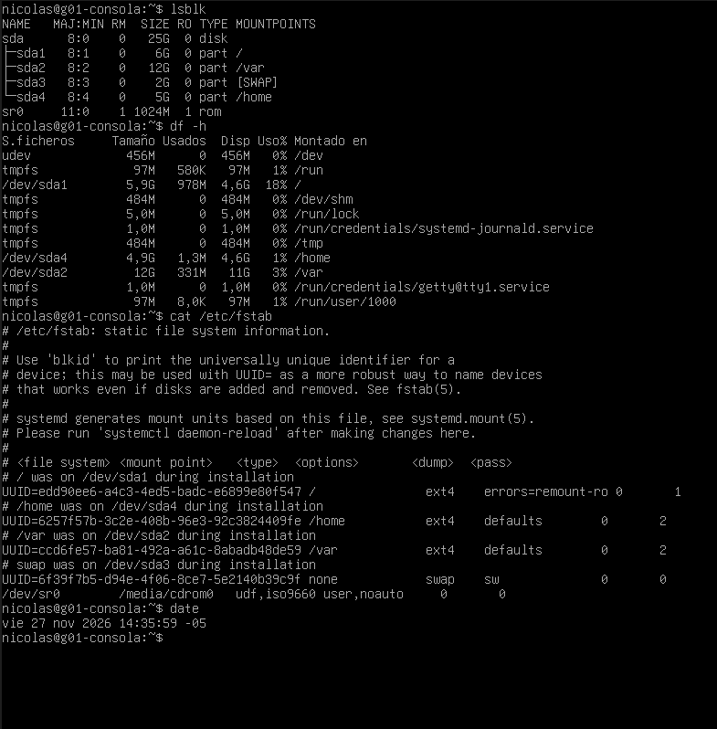

**Captura 5: Las 5 herramientas instaladas (`make`, `rsync`, `curl`, `git`, `wget`) mostrando su versión**
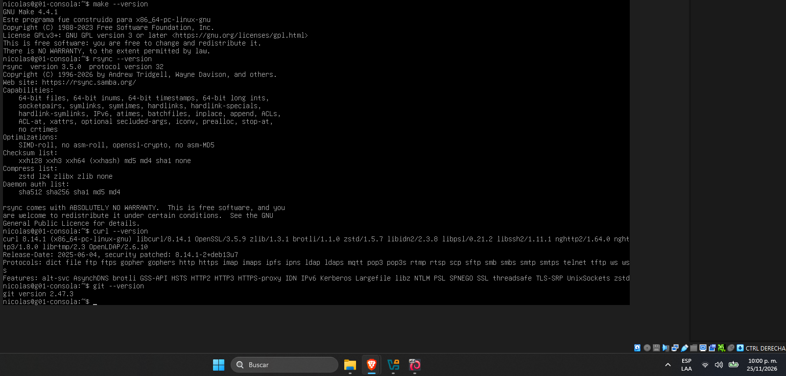
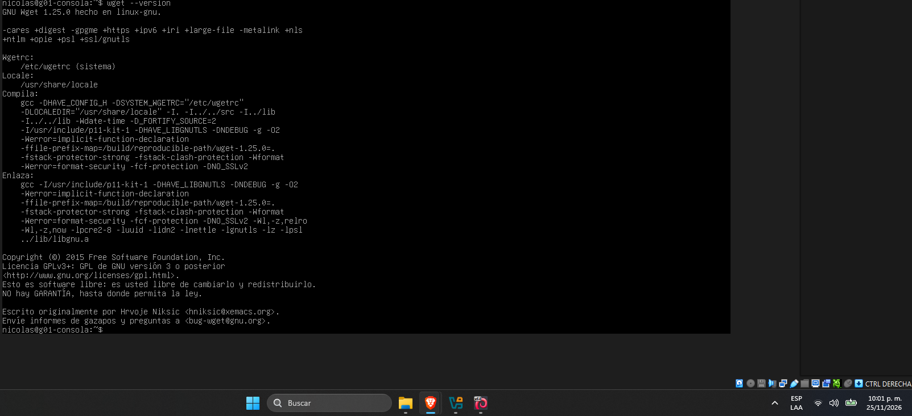

---

## 3. Red (`g01-grafica` y `g01-consola`)

Configuramos dos adaptadores de red en VirtualBox para cada máquina virtual: el adaptador 1 en modo **NAT** (para salida a internet) y el adaptador 2 en **Red solo-anfitrión** (*Host-Only*), permitiendo la comunicación directa entre ambas VMs dentro de la misma subred.

**Comandos ejecutados:** `date`, `ip a`, `ping -c 4  192.168.56.10`, `ping -c 4  192.168.56.102`

**Captura 6: Salida de `ip a` en `g01-grafica` y `g01-consola` mostrando las direcciones IP de ambas interfaces**
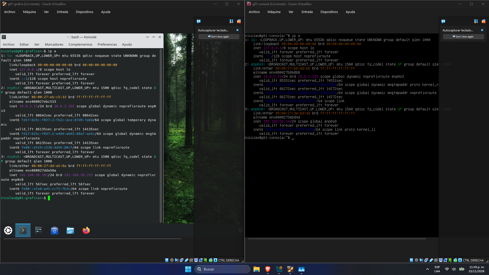


**Captura 7: Prueba de conectividad con `ping` en ambos sentidos (gráfica → consola y consola → gráfica)**
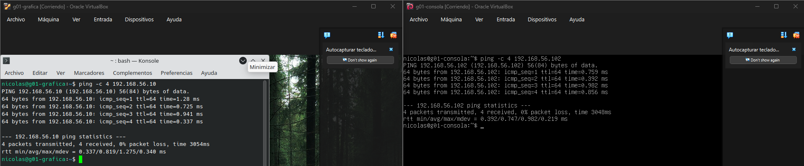


---

## 4. SSH (`g01-grafica` → `g01-consola`)

Establecimos conexión remota mediante el protocolo SSH desde la terminal de la máquina virtual gráfica (`g01-grafica`) hacia la máquina virtual de consola (`g01-consola`) utilizando su dirección IP en la red solo-anfitrión.

**Comando ejecutado:** `ssh nicolas@192.168.56.10` 

**Captura 8: Sesión SSH abierta desde `g01-grafica` mostrando el prompt remoto `nicolas@g01-consola` y `date`**
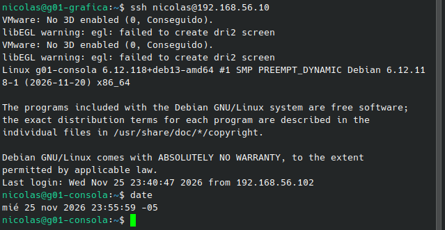

---

## 5. Instantáneas (`instalacion-limpia`)

Con ambas máquinas virtuales apagadas y la instalación base verificada, tomamos una instantánea llamada `instalacion-limpia` en VirtualBox para cada VM como punto de restauración seguro.

**Captura 9: Pestaña de instantáneas de `g01-grafica` mostrando `instalacion-limpia`**
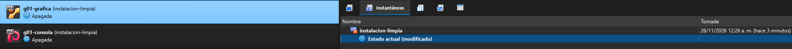

**Captura 10: Pestaña de instantáneas de `g01-consola` mostrando `instalacion-limpia`**
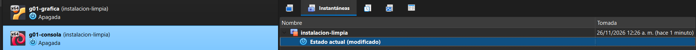


---

## Código del sprint

El docente publicó el código de verificación en el campus 48 horas antes del cierre. Lo guardamos en el home del usuario principal de ambas VMs y lo mostramos en el video con `date`.

**Comandos ejecutados:**
```bash
echo "YD01-WEWS" > ~/codigo_sprint1.txt
cat ~/codigo_sprint1.txt
date
```
**Captura 11: Salida del codigo de verificación y date**
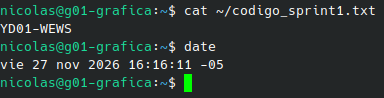
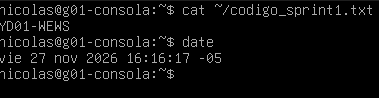


---

## Lo que hizo cada integrante en este sprint

| Integrante | Qué hizo | Commits |
|---|---|---|
| Jaycob | Configuró GitHub Pages (`_config.yml`), creó la portada (`index.md`), estructuró la página `sprint-1.md`, integró las capturas y subió el video. | 2 |
| Nicolás | Instaló `g01-grafica` (Kubuntu) y `g01-consola` (Debian) con particionado manual, configuró red (NAT + Solo-anfitrión), SSH y tomó las instantáneas `instalacion-limpia`. | 2 |
| Alejandro | Verificó herramientas en consola, completó `plan/ficha-version.md` y participó en la sustentación en video. | 2 |

<link rel="stylesheet" href="//cdn.jsdelivr.net/npm/viewerjs@1.11.6/dist/viewer.min.css">
<script src="//cdn.jsdelivr.net/npm/viewerjs@1.11.6/dist/viewer.min.js"></script>
<script>
  document.addEventListener("DOMContentLoaded", function() {
    new Viewer(document.body, {
      toolbar: true,
      navbar: false,
      title: false,
      zoomRatio: 0.25
    });
  });
</script>

